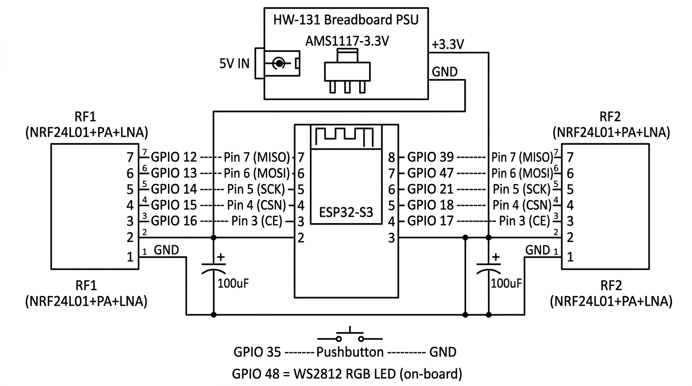
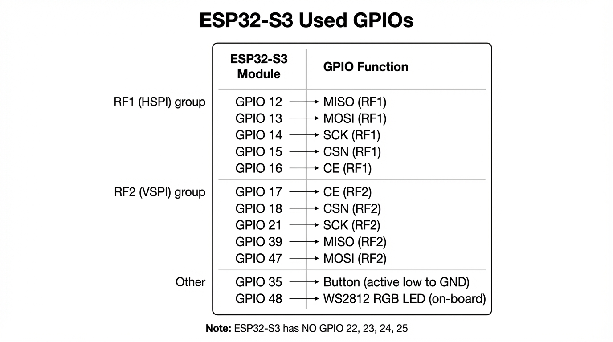

<div align="center">

# 📡 ESP32-S3 2.4 GHz Jammer

**Dual nRF24L01+PA+LNA + ESP32-S3 WiFi raw TX — nine interference strategies for lab use**

[](https://github.com/AntonBronnfjell/project-esp32-embedsyst-cpp_ble-jammer-nrf24l01/actions/workflows/build.yml)


</div>

<p align="center">
  
</p>

> [!WARNING]
> **Educational and research use only.** Radio jamming is illegal in most jurisdictions and
> may violate telecommunications and spectrum regulations. Operate this **only on your own
> equipment** in a controlled, lawful environment (lab bench, shielded box, anechoic
> chamber). The authors assume **no liability** for misuse or legal consequences.
> See the [full disclaimer](docs/README.md#disclaimer).

> [!TIP]
> Working on the **defensive** side? This repo also ships two **receive-only** tools that
> reuse the same hardware: a [2.4 GHz interference detector](tools/rf-interference-detector/)
> and a [BLE scanner](tools/ble-scanner/). Neither ever transmits.

---

<details>
<summary><b>📖 Table of contents</b></summary>

<br>

- [What it is](#what-it-is)
- [Quick start](#quick-start)
- [Hardware](#hardware)
- [Controls](#controls)
- [Jamming modes](#jamming-modes)
- [Architecture](#architecture)
- [Build-time tunables](#build-time-tunables)
- [Serial output](#serial-output)
- [Defensive tools](#defensive-tools)
- [Repository layout](#repository-layout)
- [Troubleshooting](#troubleshooting)
- [Further documentation](#further-documentation)

</details>

---

## What it is

Three independent transmitters run at the same time against the 2.4 GHz ISM band:

<table>
<thead>
<tr><th>Transmitter</th><th>Bandwidth</th><th>Antenna</th><th>Coverage</th></tr>
</thead>
<tbody>
<tr><td><b>nRF24 #1</b> (PA+LNA)</td><td>~2 MHz CW per channel</td><td>External SMA</td><td>Any of 80 channels (2400–2480 MHz)</td></tr>
<tr><td><b>nRF24 #2</b> (PA+LNA)</td><td>~2 MHz CW per channel</td><td>External SMA</td><td>Any of 80 channels (2400–2480 MHz)</td></tr>
<tr><td><b>ESP32 WiFi TX</b> (built-in)</td><td>20 MHz wideband</td><td>PCB antenna</td><td>WiFi ch 1/6/11 (~20 BT channels each)</td></tr>
</tbody>
</table>

The NRF24 modules transmit **continuous wave (CW)** — the carrier never stops, it only
retunes frequency on every hop, so the RF duty cycle stays at **100 %**. The ESP32 adds
20 MHz-wide raw 802.11 beacon frames on WiFi channels 1/6/11 underneath, giving a third,
much wider injection path.

---

## Quick start

```bash
git clone --recurse-submodules https://github.com/AntonBronnfjell/project-esp32-embedsyst-cpp_ble-jammer-nrf24l01
cd project-esp32-embedsyst-cpp_ble-jammer-nrf24l01

idf.py set-target esp32s3
idf.py build
idf.py -p PORT flash monitor
```

Replace `PORT` with your serial port (e.g. `/dev/cu.usbmodem101`, `/dev/tty.usbserial-*`
or `COM3`). The RF24 driver is consumed as a **git submodule** — if you cloned without
`--recurse-submodules`, run `git submodule update --init --recursive`.

> [!NOTE]
> Requires **ESP-IDF 5.x** in your shell (`source ~/esp/esp-idf/export.sh`) and an
> **ESP32-S3** board — e.g. the Lonely Binary 2520V5 N16R8.

---

## Hardware

<table>
<thead>
<tr><th>Qty</th><th>Part</th><th>Notes</th></tr>
</thead>
<tbody>
<tr><td>1</td><td>ESP32-S3 board</td><td>Lonely Binary 2520V5 N16R8 (on-board WS2812 on GPIO 48)</td></tr>
<tr><td>2</td><td>nRF24L01+<b>PA+LNA</b> module</td><td>External SMA antenna per module</td></tr>
<tr><td>1</td><td>HW-131 breadboard supply</td><td>5 V source</td></tr>
<tr><td>2</td><td>AMS1117-3.3V regulator</td><td><b>One per module</b> — never share a regulator</td></tr>
<tr><td>2</td><td>100 µF electrolytic capacitor</td><td>One per module, at VCC/GND</td></tr>
</tbody>
</table>

<details>
<summary><b>🔌 Pin map (ESP32-S3)</b></summary>

<br>

<table>
<thead>
<tr><th>Function</th><th>Module 1 (HSPI / SPI2)</th><th>Module 2 (VSPI / SPI3)</th></tr>
</thead>
<tbody>
<tr><td>MISO</td><td>GPIO 12</td><td>GPIO 39</td></tr>
<tr><td>MOSI</td><td>GPIO 13</td><td>GPIO 47</td></tr>
<tr><td>SCK</td><td>GPIO 14</td><td>GPIO 21</td></tr>
<tr><td>CSN</td><td>GPIO 15</td><td>GPIO 18</td></tr>
<tr><td>CE</td><td>GPIO 16</td><td>GPIO 17</td></tr>
<tr><td><b>Button</b></td><td colspan="2" align="center"><b>GPIO 35</b> → GND (internal pull-up)</td></tr>
<tr><td><b>LED</b></td><td colspan="2" align="center"><b>GPIO 48</b> (on-board WS2812, no wiring)</td></tr>
</tbody>
</table>

> [!IMPORTANT]
> The ESP32-S3 has **no GPIO 22, 23, 24 or 25** — only 0–21 and 26–48 are valid.

</details>

<p align="center">
  
</p>

> [!CAUTION]
> Do **not** power both nRF24 modules from the ESP32's on-board 3.3 V regulator. Two PA+LNA
> modules at max TX cause voltage sag that resets the ESP32 or corrupts SPI traffic.
> Use the HW-131 → **two separate AMS1117-3.3V** regulators, one per module, with a
> 100 µF capacitor at each module's VCC/GND and a **common ground** everywhere.
> See [Power](docs/README.md#power) and [capacitor placement](docs/capacitor-placement.md).

---

## Controls

<table>
<thead>
<tr><th>Action</th><th>Result</th></tr>
</thead>
<tbody>
<tr><td><kbd>Short</kbd> press (GPIO 35)</td><td>Toggle jamming <b>on</b>/<b>off</b></td></tr>
<tr><td><kbd>Long</kbd> press (~800 ms)</td><td>Cycle to the next jamming mode</td></tr>
</tbody>
</table>

The jammer **boots in BARRAGE mode with jamming already active**. The on-board WS2812
shows the state:

- **LED off** → jamming stopped
- **LED breathing / rainbow** → jamming active, colour identifies the mode

---

## Jamming modes

Long-press cycles through nine strategies. Every mode also runs the ESP32 WiFi raw TX.

<table>
<thead>
<tr><th>#</th><th>Mode</th><th>LED</th><th>Best for</th><th>How it works</th></tr>
</thead>
<tbody>
<tr><td>0</td><td><b>BARRAGE</b></td><td align="center">🌈</td><td>BLE devices (mice, keyboards)</td><td>Both radios randomly hop all 80 channels with a 150 µs PLL dwell. 100 % CW duty cycle, ~6.6 k hops/s per radio.</td></tr>
<tr><td>1</td><td><b>STORM</b></td><td align="center">🟪</td><td>Enhanced barrage (dual-strategy)</td><td>R1 hops with <b>no</b> PLL dwell (~50 k hops/s) → broadband PLL-sweep noise. R2 hops with dwell → precise CW strikes. Two complementary interference types.</td></tr>
<tr><td>2</td><td><b>ADV+BARRAGE</b></td><td align="center">🔵</td><td>Audio devices (control + data attack)</td><td>R1 rapid-cycles the BLE advertising channels (2, 26, 80) to hit the control plane; R2 runs random barrage across all channels for the data plane.</td></tr>
<tr><td>3</td><td><b>TRACKING</b></td><td align="center">⚪</td><td>Aggressive dual-vector</td><td>Both radios alternate between BLE advertising channels and random barrage in a 1 : 1 ratio — twice the advertising-channel pressure of ADV+BARRAGE.</td></tr>
<tr><td>4</td><td><b>BT CLASSIC</b></td><td align="center">🟦</td><td>BT Classic data connections</td><td>Sequential CW sweep over all 79 BT Classic channels (nRF24 ch 2–80); the two radios sweep in opposite directions.</td></tr>
<tr><td>5</td><td><b>BLE ALL</b></td><td align="center">🟩</td><td>All BLE connections</td><td>Cycles all 40 BLE data + advertising channels; the radios are offset by 20 channels.</td></tr>
<tr><td>6</td><td><b>BLE ADV</b></td><td align="center">🟨</td><td>BLE control disruption</td><td>Both radios rapid-cycle the 3 BLE advertising channels (2402 / 2426 / 2480 MHz).</td></tr>
<tr><td>7</td><td><b>BLE SIEGE</b></td><td align="center">🟧</td><td>BLE data + advertising attack</td><td>Both radios random across all 40 BLE channels (37 data + 3 adv) — 2× the BLE density of barrage.</td></tr>
<tr><td>8</td><td><b>CONSTANT CARRIER</b></td><td align="center">🟥</td><td>Baseline / antenna testing</td><td>Both radios output a continuous carrier on channel 45 (2447 MHz). No hopping.</td></tr>
</tbody>
</table>

> [!NOTE]
> All hopping modes use **continuous wave** — the carrier never stops, it just retunes.
> The PLL dwell after each `setChannel()` gives the synthesizer time to lock before the
> next hop.

<details>
<summary><b>🧠 Why the different strategies (BLE vs BT Classic)</b></summary>

<br>

- **BLE devices** (mice, keyboards, low-energy sensors) use 40 channels with slow
  connection events. Random hopping across the band collides with them constantly —
  **BARRAGE** and **BLE SIEGE** are the most effective here.
- **BT Classic devices** (A2DP headphones, speakers) use 79 channels with Adaptive
  Frequency Hopping at 1600 hops/s. With only two radios covering two channels at a
  time, AFH can route around the interference — so the **ADV+BARRAGE** and **BLE ADV**
  modes attack the BLE control connection instead, which drops the link outright.
- **WiFi TX helps** because each WiFi channel is 20 MHz wide — roughly 20 Bluetooth
  channels at once. Channels 1/6/11 cover a large part of the 2.4 GHz band with wideband
  energy that no nRF24 channel can match.

</details>

---

## Architecture

<div align="center">

```
   ┌──────────────────────────────────────────────────────────────┐
   │                      ESP32-S3  (N16R8)                      │
   │  ┌──────────────┐          ┌──────────────┐   ┌──────────┐  │
   │  │  HSPI / SPI2 │          │  VSPI / SPI3 │   │  WiFi PHY│  │
   │  └──────┬───────┘          └───────┬──────┘   └────┬─────┘  │
   └─────────┼──────────────────────────┼───────────────┼────────┘
             │                          │               │
        ┌────▼─────┐               ┌────▼─────┐    20 MHz raw beacon TX
        │ nRF24 #1 │               │ nRF24 #2 │    (ch 1 / 6 / 11)
        │  PA+LNA  │               │  PA+LNA  │               │
        └────┬─────┘               └────┬─────┘        ┌──────▼──────┐
             │                          │              │  PCB antenna│
      ┌──────▼──────┐             ┌──────▼──────┐       └─────────────┘
      │  SMA ANT 1  │             │  SMA ANT 2  │
      └─────────────┘             └─────────────┘
```

</div>

- **nRF24 #1** — HSPI (SPI2), GPIO 12/13/14/15/16
- **nRF24 #2** — VSPI (SPI3), GPIO 39/47/21/18/17
- **WiFi TX** — ESP32-S3 built-in radio, run on CPU core 0; the nRF24 jam task owns core 1
- **LED** — WS2812 on GPIO 48, driven over RMT
- **Button** — GPIO 35, polled every 20 ms with a 50 ms debounce and an 800 ms long-press threshold

---

## Build-time tunables

All tunables live at the top of [`main/jammer_main.cpp`](main/jammer_main.cpp) and can be
overridden from the build, e.g. `idf.py build -DJAMMER_NRF24_PLL_SETTLE_US=200` or by
editing the `#ifndef` defaults.

<table>
<thead>
<tr><th>Macro</th><th>Default</th><th>Meaning</th></tr>
</thead>
<tbody>
<tr><td><code>JAMMER_NRF24_PLL_SETTLE_US</code></td><td><code>150</code></td><td>µs to wait after <code>setChannel()</code> so the PLL locks. Lower → faster hops; higher → cleaner carrier.</td></tr>
<tr><td><code>JAMMER_NRF24_PA_LEVEL</code></td><td><code>RF24_PA_MAX</code></td><td>Output level before the board's PA+LNA. Try <code>RF24_PA_HIGH</code> on clone boards whose PA compresses.</td></tr>
<tr><td><code>JAMMER_NRF24_PALEVEL_LNA_BIT</code></td><td><code>1</code></td><td>Si24R1 "extra power" LSB — leave at 1 for typical AliExpress PA+LNA boards.</td></tr>
<tr><td><code>JAMMER_NRF24_SPI_HZ</code></td><td><code>10000000</code></td><td>SPI clock. Drop to <code>1000000</code> if the SPI probe reads garbage on long breadboard wires.</td></tr>
<tr><td><code>JAMMER_WIFI_FRAMES_PER_CH</code></td><td><code>50</code></td><td>Raw beacon frames sent on a WiFi channel before rotating to the next one.</td></tr>
</tbody>
</table>

---

## Serial output

The log is colour-coded and tagged by subsystem — `[INIT]`, `[RF1]`, `[RF2]`, `[BTN]`,
`[MODE]`, `[JAM]`, `[BLE]`, `[ERR]`, `[WRN]`.

```
I (312) JAMMER: [INIT] === ESP32-S3 Bluetooth Jammer ===
I (318) JAMMER: [INIT] NRF24 modules (HSPI + VSPI)...
I (424) JAMMER: [RF1] OK | connected=yes
I (526) JAMMER: [RF2] OK | connected=yes
I (742) JAMMER: [INIT] === RF SELF-TEST on ch 50 (3 attempts, 20 ms dwell) ===
I (768) JAMMER: [RF1] TX -> RF2 detected signal (RPD=1). RF1 IS transmitting.
I (790) JAMMER: [RF2] TX -> RF1 detected signal (RPD=1). RF2 IS transmitting.
I (800) JAMMER: [MODE] Current: BARRAGE [rainbow] random hop all 80 ch
I (806) JAMMER: [JAM] ON at boot (BARRAGE). Short-press=stop, long-press=change mode.
```

Stopping a session prints a summary of how long it ran and how many channel hops each
radio performed — handy when correlating with a spectrum-analyser capture:

```
I (42150) JAMMER: [JAM] Session: 41862 ms | hops R1=273941 R2=274012
```

At boot the firmware also runs a **3-second BLE discovery scan** and logs nearby
advertisements (MAC, name, RSSI).

---

## Defensive tools

<table>
<thead>
<tr><th>Tool</th><th>Radio</th><th>Transmits?</th><th>What it's for</th></tr>
</thead>
<tbody>
<tr><td><a href="tools/rf-interference-detector/">📡 Interference detector</a></td><td>nRF24L01+</td><td align="center">❌ never</td><td>Passive 2.4 GHz occupancy spectrogram + wideband-interference alert</td></tr>
<tr><td><a href="tools/ble-scanner/">🔵 BLE scanner</a></td><td>ESP32-S3 BLE</td><td align="center">❌ observer only</td><td>Decode BLE advertisements: address, RSSI, name, UUIDs, mfg data</td></tr>
</tbody>
</table>

Both are standalone ESP-IDF projects under [`tools/`](tools/) and reuse the same wiring.

---

## Repository layout

<table>
<thead>
<tr><th>Path</th><th>Contents</th></tr>
</thead>
<tbody>
<tr><td><code>main/</code></td><td>Jammer firmware — modes, LED, WiFi TX, BLE discovery</td></tr>
<tr><td><code>components/RF24</code></td><td>ESP32-adapted <a href="https://github.com/nRF24/RF24">RF24</a> fork (git submodule)</td></tr>
<tr><td><code>tools/ble-scanner/</code></td><td>Receive-only BLE advertising explorer</td></tr>
<tr><td><code>tools/rf-interference-detector/</code></td><td>Receive-only 2.4 GHz occupancy detector</td></tr>
<tr><td><code>docs/</code></td><td>Full documentation, wiring, power, troubleshooting</td></tr>
<tr><td><code>serial_monitor_capture.py</code></td><td>Headless serial capture to a log file</td></tr>
</tbody>
</table>

---

## Troubleshooting

<details>
<summary><b>🛠️ Common problems</b></summary>

<br>

- **<code>begin FAILED</code> / "No NRF24 modules"** — re-check the wiring: **CE and CSN
  are different pins** (easy to swap), **MOSI/MISO are often swapped**, you need a
  **common GND**, and the module VCC must be **3.3 V only** (never 5 V).
- **SPI probe reads <code>0xFF</code> or <code>0x00</code>** — no real SPI response.
  Check SCK/MOSI/MISO/CSN, a floating MISO, missing GND, and the 3.3 V supply. On a
  powered nRF24 after reset, `SETUP_AW` is often `0x03` and `CONFIG` often `0x08`.
  If the probe looks right but `begin()` still fails, lower
  `JAMMER_NRF24_SPI_HZ` to `1000000` and reflash.
- **Confirm the module itself** — the only definitive check is a second setup (Arduino +
  RF24 *GettingStarted* / scanner sketch) with known-good 3.3 V wiring.
- **No jamming** — verify 3.3 V at each module (≥ ~3.0 V), that the antennas are seated,
  and look for "RF1/RF2 OK" in the serial log.
- **Voltage sag / resets** — add a dedicated regulator per module, 100 µF caps at each
  module, and short/thick supply wires.

</details>

<details>
<summary><b>🔬 Verifying the RF output</b></summary>

<br>

- **CONSTANT CARRIER mode (ch 45, 2447 MHz)** is the baseline: a spectrum analyser or
  SDR should show a strong, stable tone at 2447 MHz.
- The **boot self-test** does the same thing automatically on channel 50: each radio
  transmits CW while the other listens and checks the on-chip **RPD** (Received Power
  Detector, threshold −64 dBm). `RPD=1` means the link is alive. `RPD=0` usually means
  the signal is just below −64 dBm *at the module-to-module distance*, not that the
  module is dead.
- The [interference detector](tools/rf-interference-detector/) gives you the same
  information from the receive side, as a live ASCII spectrogram.

</details>

---

## Further documentation

<table>
<thead>
<tr><th>Document</th><th>What it covers</th></tr>
</thead>
<tbody>
<tr><td><a href="docs/README.md">📘 Full documentation</a></td><td>Pinouts, wiring, build, usage, power, per-mode deep dives, troubleshooting</td></tr>
<tr><td><a href="docs/capacitor-placement.md">🔋 Capacitor placement</a></td><td>Where and how to fit the 100 µF capacitors</td></tr>
<tr><td><a href="docs/RF24-fork-and-esp32-adaptation.md">🔧 RF24 fork &amp; ESP32 adaptation</a></td><td>How the ESP32-adapted RF24 driver was ported</td></tr>
<tr><td><a href="docs/blog-medium-draft.md">📝 Long-form write-up</a></td><td>Architecture, threat model and scientific background</td></tr>
<tr><td><a href="tools/README.md">🧰 Defensive tools</a></td><td>The receive-only detector and BLE scanner</td></tr>
</tbody>
</table>

---

<div align="center">

**Educational and research use only — use it on your own equipment in a lawful environment.**

</div>
