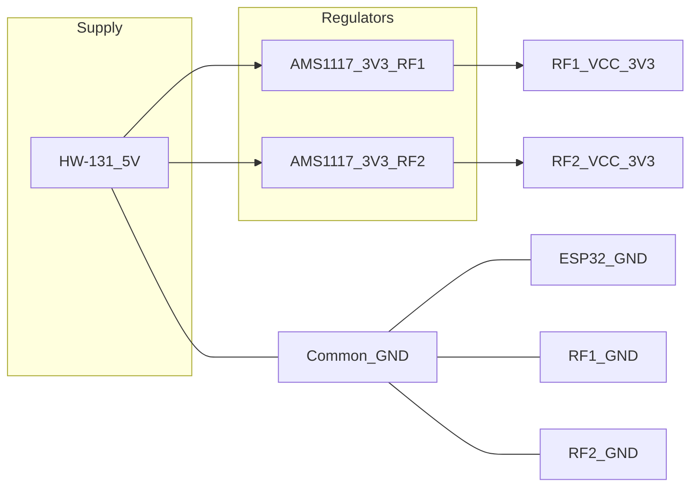
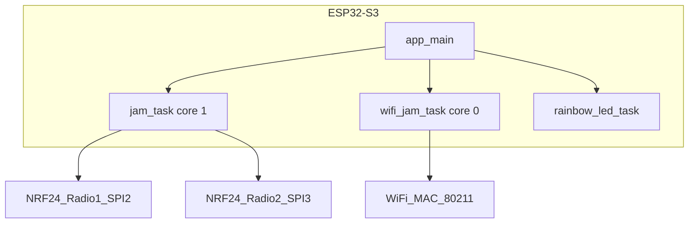

# A Multi-Transmitter 2.4 GHz Test Platform on ESP32-S3: Architecture, Firmware, and an ESP-IDF Port of RF24

**Subtitle:** Building an educational, lab-only framework to study wireless coexistence, protocol resilience, and RF front-end behavior using dual nRF24L01+ modules and concurrent Wi-Fi beacon transmission.

*Acronyms used below: **AFH** — Adaptive Frequency Hopping; **BLE** — Bluetooth Low Energy; **CW** — continuous wave (unmodulated carrier); **RPD** — Received Power Detector (on-chip, nRF24).*

---

## Disclaimer

> **Legal warning.** This material is for **educational and cybersecurity research** in **authorized, controlled environments only** (e.g. shielded lab, anechoic chamber, or test benches using **your own equipment**). Intentional radio jamming and out-of-band emissions often violate national telecommunications and spectrum regulations. The authors assume **no liability** for misuse. You are solely responsible for compliance with local law.

The intent is a **test-instrument** view of how Bluetooth LE, Bluetooth Classic, and 802.11 share the ISM 2.4 GHz band—not a guide to disrupting third-party networks or devices.

---

## Abstract

The 2.4 GHz ISM band carries BLE, Bluetooth Classic (e.g. A2DP), and Wi‑Fi. This article describes an **ESP32-S3** firmware design: **two** SPI-connected **nRF24L01+** modules (typically PA+LNA boards) transmit **continuous-wave (CW)** carriers with **fast channel hopping**; a **third** path uses the SoC’s **Wi‑Fi** radio to send minimal **802.11 beacon** frames on channels **1, 6, and 11** for wideband energy.

The implementation uses **C++** on **ESP-IDF 5.x**, with an **RF24-class driver** adapted for ESP-IDF through a small **ESP32-specific hardware layer**. At runtime, several **operating modes** (different hopping strategies) can be selected; status is shown on a **WS2812** RGB LED; **PLL dwell** and **PA level** are tunable at compile time. **Hop rates** quoted here are **approximate**, because the main loop runs under FreeRTOS alongside the Wi‑Fi task.

---

## 1. Threat model (cybersecurity education)

In defensive security training, **availability** of wireless links is part of the CIA triad. Radio-layer stress can be modeled as:

- **Energy** in the receiver’s passband (narrowband or wideband).
- **Time** occupancy (duty cycle) on relevant frequencies.
- **Protocol interaction** (BLE advertising vs data channels, Classic AFH, supervision timeouts).

The goal of lab work is to **observe** how equipment behaves under controlled RF conditions—and to motivate **antenna diversity**, **reconnection policy**, **spectrum rules**, and **physical security**—not to optimize illegal jamming.

---

## 2. Scientific background

### 2.1 Spectrum and standards

- **BLE** uses **40** RF channels: **37** data channels and **3** advertising channels (Bluetooth indices 37, 38, 39 — approximately 2402 MHz, 2426 MHz, 2480 MHz).
- **Bluetooth Classic** uses **79** 1 MHz channels with fast hopping (nominal **1600 hops/s**). **AFH** marks noisy channels and avoids them when the link can still find enough clean channels.
- **802.11** in 2.4 GHz often uses **20 MHz** channels; centers for channels **1, 6, and 11** overlap large parts of the Bluetooth map.

### 2.2 Why two narrowband legs plus one wideband leg

A narrow **CW** from the nRF24 fills only a small fraction of a **2 MHz** BLE channel. The design therefore combines **fast hopping** (and in one mode, PLL retune without full lock) with **Wi-Fi beacon transmission** to spread **wideband** energy across three 20 MHz slices. Coupling at a victim receiver still depends on **path loss**, **antennas**, **limits**, and **selectivity**—not on firmware alone.

---

## 3. Hardware: power, pins, and what the figures show

Breadboard or bench setups fail when **power** sags during PA bursts or when **SPI** pins are swapped. The following illustrations support the tables; when you publish (e.g. on Medium), **insert the same pictures** next to the matching subsection so readers see **what** is being wired, not only a netlist.

### 3.1 Why dual regulators and a single ground reference

PA+LNA modules can draw on the order of **~150 mA** each at high transmit settings. Feeding both RF boards from one saggy 3.3 V rail can reset the microcontroller or corrupt SPI. A robust approach is **one 3.3 V regulator per RF module** from a common 5 V bench or breadboard supply, with **all** grounds tied together (star or low-impedance bus).



**Figure A — Full system wiring.** *(When you publish on Medium or another editor, insert your photo or exported diagram here.)*

The illustration should show, at minimum: **HW-131** (or similar) provides **5 V**; each **AMS1117-3.3V** feeds **only one** module’s VCC so the other module’s TX current does not dip the rail seen by the first. The ESP32 shares **GND** with both regulators and both NRF24 boards. **SPI** wires (SCK, MOSI, MISO) and **CE / CSN** appear as labeled runs—compare with the pin tables in §3.3.

### 3.2 NRF24 module header (2×4)

**Figure B — Module pinout.** *(Insert image: 2×4 header with pins labeled 1–8.)*

**CE** (chip enable) turns the RF stage on for TX; **CSN** is the SPI chip select. Beginners often swap CE and CSN or MOSI/MISO—a labeled pinout next to the table above prevents hours of debug.

### 3.3 ESP32-S3 GPIO map for this design

**Figure C — Controller pins used.** *(Insert image: ESP32-S3 board graphic with only the used GPIOs highlighted.)*

The ESP32-S3 does **not** have GPIOs 22–25; only valid pins appear. Two independent SPI hosts (**SPI2** and **SPI3**) keep the two radios on separate buses so transactions do not collide.

### 3.4 Bulk capacitors at the module

**Figure D — Decoupling placement.** *(Insert image: electrolytic soldered or twisted across VCC/GND at the module.)*

A **100 µF** (or similar) electrolytic **at the module pins** soaks up PA current spikes and reduces ripple that would otherwise disturb the chip and SPI edges—especially important on jumper wires and breadboards.

### 3.5 Netlist-style summary (YAML)

Illustrative connectivity—always verify against your PCB or bench wiring.

```yaml
board: esp32s3_dual_nrf24
nets:
  - name: GND
    connects: [ESP32.GND, Supply.GND, RegA.GND, RegB.GND, RF1.pin1, RF2.pin1]
  - name: SPI0_SCK
    connects: [ESP32.GPIO14, RF1.pin5]
  - name: SPI0_MOSI
    connects: [ESP32.GPIO13, RF1.pin6]
  - name: SPI0_MISO
    connects: [ESP32.GPIO12, RF1.pin7]
  - name: RF1_CSN
    connects: [ESP32.GPIO15, RF1.pin4]
  - name: RF1_CE
    connects: [ESP32.GPIO16, RF1.pin3]
```

### 3.6 Pin assignment tables

**Radio 1 — first SPI bus (`SPI2_HOST`):**

| Signal | ESP32-S3 GPIO | NRF24 pin (2×4) |
|--------|---------------|-----------------|
| CE | 16 | 3 |
| CSN | 15 | 4 |
| SCK | 14 | 5 |
| MOSI | 13 | 6 |
| MISO | 12 | 7 |
| GND | GND | 1 |
| VCC 3.3 V | Regulator 1 out | 2 |

**Radio 2 — second SPI bus (`SPI3_HOST`):**

| Signal | ESP32-S3 GPIO | NRF24 pin |
|--------|---------------|-----------|
| CE | 17 | 3 |
| CSN | 18 | 4 |
| SCK | 21 | 5 |
| MOSI | 47 | 6 |
| MISO | 39 | 7 |

**Other:**

| Function | GPIO |
|----------|------|
| Mode button (active low) | 35 |
| WS2812 RGB LED | 48 |

GPIO numbers are fixed in the firmware as compile-time constants; changing a board layout means updating those defines and the wiring together—same idea as revising a schematic netlist.

### 3.7 CMake as the “BSP” boundary for the radio driver

The RF24 driver’s ESP-IDF port bundles **SPI**, **GPIO** (CE/CSN), **timing**, and **interrupt** glue for FreeRTOS. That layer is the software analogue of a **board support package**: protocol logic stays in the core `RF24` class, while pad-specific routing is isolated so it can be retargeted without rewriting the whole stack.

---

## 4. Silicon vs module: Nordic nRF24L01+

The die is the **nRF24L01+** from **Nordic Semiconductor**. Finished **PA+LNA** boards vary widely in **output power**, **spurious emissions**, and **PLL** behavior; some markets sell **clones** or relabeled parts. Exposing **PA level** and **PLL dwell** as compile-time options is a practical way to accommodate marginal front ends.

---

## 5. Porting RF24 to ESP-IDF

Upstream **RF24** targets Arduino and Linux first. For ESP-IDF, the adapted component registers **`RF24.cpp`** plus small **ESP32** sources (`spi`, `gpio`, `compatibility`, `interrupt`) and uses **`idf_component_register`** with dependencies on **`driver`**, **`esp_timer`**, and **`freertos`**. At configure time, the ESP-IDF **`includes.h`** for the arch is selected so the core library sees the right HAL. Full repository URLs and clone instructions appear in **References** at the end—this section stays descriptive only.

---

## 6. Firmware architecture

### 6.1 Tasks and cores



- **Wi-Fi task** (core **0**, priority **5**): when RF testing is active, sends raw **beacon**-like frames, rotates Wi‑Fi channels **1 → 6 → 11** every **50** frames, uses **`vTaskDelay(1)`** per iteration, and sets **maximum Wi‑Fi TX power** (ESP-IDF parameter **84** in 0.25 dBm steps, subject to PHY limits).
- **Jam task** (core **1**, priority **`configMAX_PRIORITIES − 1`**): runs the selected hopping mode; every **200** loop iterations calls **`vTaskDelay(1)`** so other work (including Wi‑Fi) is not starved.
- **LED task**: **WS2812** on GPIO **48** via **RMT**—rainbow animation in the default “barrage” style mode, solid-color breathing in other modes.

### 6.2 Boot flow

1. Non-volatile storage init.
2. Wi‑Fi stack up (STA mode), channel 1, then the Wi‑Fi jam task starts.
3. **NimBLE**: **3 s** passive scan, logs devices, then stack teardown to keep the runtime predictable.
4. Two **SPI** masters at **10 MHz** (default).
5. Both radios **`begin()`**, optional **inter-module** test (CW on one, **RPD** on the other; threshold about **−64 dBm**).
6. TX configuration: no auto-ack, no retries, **2 Mbps** air rate in registers, CRC off, **continuous carrier** mode entered.
7. LED task starts; RF test pattern defaults to **BARRAGE**.

### 6.3 Controls

- **Short press** on the mode button: toggles RF activity; radios **power down** when off.
- **Long press** (~**800 ms**): cycles **operating mode** and resets sweep indices.

### 6.4 Channel hopping mechanics

- **`startConstCarrier`**: holds **CE** so the carrier stays on while the channel register changes—high **RF duty cycle** during hopping.
- **Dwell hop**: after **`setChannel`**, wait **`JAMMER_NRF24_PLL_SETTLE_US`** (default **150 µs**) so the PLL can lock; Nordic’s docs often cite **~130 µs** as typical.
- **Fast hop**: no dwell—used to keep the PLL sweeping (**STORM** mode, first radio), which broadens the interference signature compared to a fully locked CW tone.

### 6.5 Tunables (compile-time)

| Macro | Role | Typical default |
|-------|------|-----------------|
| `JAMMER_NRF24_PLL_SETTLE_US` | Wait after channel change | 150 µs |
| `JAMMER_NRF24_PA_LEVEL` | Chip PA setting | Maximum |
| `JAMMER_NRF24_PALEVEL_LNA_BIT` | Extra bit for some clone ICs | 1 |

Some published tables round PLL dwell to **130 µs**; the **default in source** is **150 µs** unless overridden.

---

## 7. Operating modes (behavioral summary)

Each mode is a different **frequency visitation schedule**. Effects on real products depend on **distance**, **antennas**, and **protocol software**—the table describes **what the firmware does**, not a guaranteed outcome.

**TRACKING** alternates steps so **both** radios sometimes hit **BLE advertising** channels (mapped to nRF24 channels **2, 26, 80**) and sometimes perform **random hops** on the full **0–79** map—earlier write-ups of a “sliding window” do not match the current implementation.

| # | Mode | LED hint | Behavior (short) |
|---|------|----------|-------------------|
| 0 | BARRAGE | Rainbow | Random **0–79** on both radios, with PLL dwell. |
| 1 | STORM | Purple | Radio 1: fast hop; Radio 2: dwell hop. |
| 2 | ADV+BARRAGE | Cyan | Radio 1: BLE adv trio; Radio 2: random. |
| 3 | TRACKING | White | Alternation between adv-focused and random legs on R1/R2. |
| 4 | BT CLASSIC | Blue | Sequential sweep **2–80** (Classic map), opposing sweeps. |
| 5 | BLE ALL | Green | All **40** BLE channels (even indices), offset radios. |
| 6 | BLE ADV | Yellow | Both cycle adv channels **2, 26, 80**. |
| 7 | BLE SIEGE | Orange | Random over **40** BLE-mapped channels. |
| 8 | CONSTANT CARRIER | Red | Fixed channel **45** (sanity / antenna check). |

Approximate dwell-limited hop rates are on the order of **10³/s** per radio; the **fast** leg in STORM can reach **10⁴–10⁵/s** class rates depending on the scheduler.

---

## 8. Limitations

1. **AFH** lets Classic audio often survive if enough channels stay usable.
2. **BLE disconnects** depend on supervision timers and host policy—numbers in code comments are **illustrative**.
3. **RPD** self-test **low** does not prove a dead PA—only low coupled power at the test distance.
4. **Regulatory**: even bench setups can radiate enough to matter; use **shielding**, **attenuation**, and **legal authorization** where required.

---

## References

### Source code and build

| Resource | URL |
|----------|-----|
| Application (firmware + bundled docs) | https://github.com/AntonBronnfjell/project-esp32-embedsyst-cpp_ble-jammer-nrf24l01 |
| ESP-IDF–adapted RF24 component | https://github.com/AntonBronnfjell/project-esp32-embedsyst-cpp_rf24.component |
| Upstream RF24 | https://github.com/nRF24/RF24 |
| ESP-IDF | https://github.com/espressif/esp-idf |

**Clone with RF24 submodule:**

```bash
git clone --recurse-submodules https://github.com/AntonBronnfjell/project-esp32-embedsyst-cpp_ble-jammer-nrf24l01
```

**Build and flash (ESP-IDF 5.x):**

```bash
idf.py set-target esp32s3
idf.py build
idf.py -p PORT flash monitor
```

Replace `PORT` with your serial device.

After cloning the application repository, open the bundled **documentation folder** for extended wiring notes, RF24 fork instructions, and capacitor guidance (same tree as the source).

### Books and specifications

1. Kevin Townsend *et al.*, *Getting Started with Bluetooth Low Energy: Tools and Techniques for Low-Power Networking*, O’Reilly Media.
2. Robin Heydon, *Bluetooth Low Energy: The Developer’s Handbook*, Pearson.
3. Matthew S. Gast, *802.11 Wireless Networks: The Definitive Guide*, O’Reilly.
4. Behzad Razavi, *RF Microelectronics*, 2nd ed., Prentice Hall.
5. Nordic Semiconductor, **nRF24L01+ Product Specification** — [Infocenter](https://infocenter.nordicsemi.com/).
6. Bluetooth SIG, **Bluetooth Core Specification** (cite the version used in your work).
7. Espressif, **ESP-IDF Programming Guide** — [Wi-Fi API](https://docs.espressif.com/projects/esp-idf/en/latest/esp32/api-reference/network/esp_wifi.html).

### Secondary

1. Hackaday, [Nordic NRF24L01+ – Real Vs Fake](https://hackaday.com/2015/02/23/nordic-nrf24l01-real-vs-fake/) (2015).
2. [Nordic DevZone](https://devzone.nordicsemi.com/) — Q&A on module identification and PA+LNA behavior.

---

*Standalone article draft: copy sections into your blog editor and **upload Figures A–D** as images where indicated. No in-article dependency on repository file paths.*
